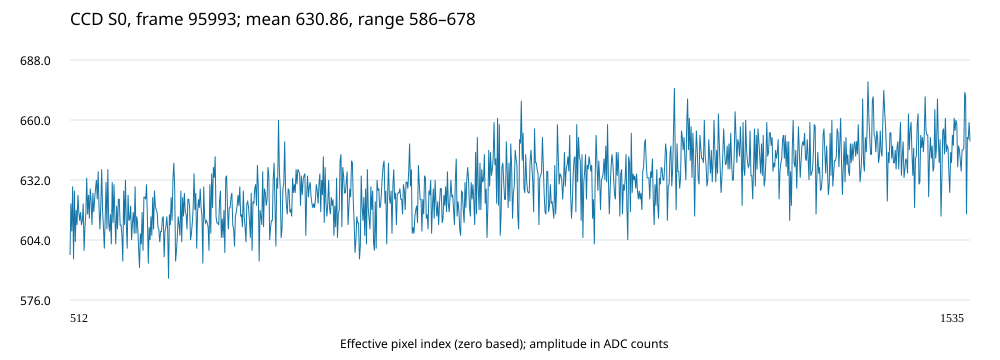

# TCD1209 光谱采集与 FPGA 测距工作台操作说明书

2026-10-24升级入口：[曝光、关灯与科研导出说明](曝光关灯与科研导出升级.md)。新固件26102402支持200 μs起、长曝光、独立距离输出间隔及8个用户灯关闭；新应用为build/viewer_research_dist/viewer.exe，连接新版后选择“12.5 MHz新版”再应用配置。以下2026-10-04的422.8～999.8 μs限制仅属于旧5 MHz固件兼容模式，不是新版限制。科研记录仍先保存SPIF/距离CSV，结束后可批量导出HDF5及可选光谱CSV。

版本：2026-10-04，上位机参考平均/可撤销平滑、实测评估及ADC钳位保护固化更新。

最终验收：用户确认重新进行20 ns/40 ns临时下载对比后，按实验原型验收结束。本轮三次各5000有效RESULT、主机1608～1617 Hz，64项主机回归通过；恢复26100301并取得停止ACK，未写Flash。当前W=40/T=600 μs，原S和修正版K易失版本1/1。完整外部电气签核限制保留，真实光学精度验证由用户完成；见`实验原型验收.md`。

更新：控制版增加显式开始/停止、停止排空ACK、安全关闭和按硬件时间戳实时回放。FPGA上电默认停止，USB连接只进入准备状态。控制版已完成临时下载实机门限、Flash写前全片比对、烧写/Verify、编程后全片读回及Master-SPI重启复测。

2026-10-03补充：ADC钳位保护候选26100301已易失下载，钳位帧实机INVALID检查通过并取得STOP ACK，尚未更新Flash。断电仍启动原控制版26092402。候选实现约束范围和剩余有效光谱验收见`ADC钳位保护验证.md`；旧固化版可能对全4095给出未标无效的数值，必须先检查S0，不可把它当作真实距离。

2026-10-04用户降低光强后，256帧S0无钳位，5000个连续RESULT均未标INVALID，硬件时间戳1666.67 Hz、主机接收1616.55 Hz；非钳位输入数值处理吞吐通过≥1000 Hz门限，STOP ACK确认。随后按用户授权备份并固化26100301，全片读回及Master-SPI重载通过；用户确认整板断电重启后，仅USB复测启停/S/K保持及5000个RESULT通过，主机1616.03 Hz，最终STOP ACK确认。首轮静默读出现一次驱动错误，重试通过，详见免下载器启动说明。真实干涉距离准确度不在这次弱光速率测试中验证。

## 1. 项目范围与当前版本

新版K复测补充：2026-10-04修正版K严格递增。原始S下重采样改善重复性但增大绝对误差；31点平滑S下仍以不重采样相位法P95最低（约0.1872 μm），不是笼统地所有门限都失败。最新本地标定草稿为build/positions_20261004_k_revision1/calibration/original_S_revised_K_fit512.npz；可选31点平滑草稿为同目录box31_S_revised_K_fit512.npz，保存了原始S备份，可撤销平滑。先停采并应用W=40/T=600 μs，再读取所选NPZ、发送S/K且确认两个ACK后启动；本次分析没有自动更新FPGA标定或Flash。不要对已经平滑的S再次外部叠加平滑。

算法决策（2026-10-04）：保留复数主峰滤波、IFFT相位展开及真实K最小二乘斜率法。修正版K下，线性和自然三次样条重采样达到原始S下的重复性收益门限，但P95误差变差；准确度优先不部署重采样，粗峰也不部署。参考S保留多帧平均和可撤销平滑；31点平滑是本批最佳候选，不是已证明普遍最优的标定。无需为此重新烧写Flash。

系统由 TCD1209DG、AD9945 B板、ACX720-V3（xc7a200tfbg484-2）、板载 JTAG 下载器、J5 FX2 USB2.0 数据接口和 Python 上位机构成。按用户确认的验收范围，本项目验证 CCD 实机采集及内部算法仿真；光路调试、真实干涉条纹测距和物理精度验证由用户完成。

当前已固化镜像为 `build/clipping_deploy/instrument_clipping.bit`，SHA256 `7B1ADC9B5680D0FF34C31CA44EDC8FBCC7F07F7D4CC5212CCB6BD1531C135412`，USR_ACCESS=`26100301`；上一控制版 `build/control_deploy` 和整片备份 `build/clipping_flash_audit/flash_before_program.bin` 保留作回退。新版 `viewer.exe` SHA256为`41982C6C6F94EFDAE5534386D9B97F6EC56B81FB110E8F35A5D4BCE4A87DE5A1`，包含旧记录manifest初始T的回放修复，62项主机回归通过。USB FIFO时钟30 MHz、CCD像素时钟5 MHz。默认W=512、T=422.8 μs（约2365帧/秒），可在线调整；实际光谱传输数量取决于S0输出间隔和主机吞吐。

所选1024点S0任一点等于0或4095，新版会将整帧RESULT标为INVALID，上位机显示“无效”并在距离曲线留空；RAW仍可用于诊断。下一健康帧自动恢复。该保护不证明未钳位帧一定存在真实干涉主峰，也不替代正确S/K及光学标定。S/K及W/T设置仍是易失配置，断电后须在上位机重新应用。

v3携带100 MHz时基的64位帧时间戳，每tick为10 ns；RAW与对应RESULT传递同一帧时间，用于上位机时间曲线。它不是计算机日历时间，复位后重新计时。历史v2记录没有有效时间戳，应按结果序号显示。12.5 MHz采样率下的连续处理已通过内部仿真，不能等同于CCD实物已验证12.5 MHz。

## 2. 硬件连接

1. B板P3与开发板P7（GPIO0）同号直通；Bank16 VCCO为3.3 V。更改排线前断电，确认方向和公共地。
2. 板载Type-C JTAG接口只在开发、下载和恢复时使用；J5负责FX2数据收发。日常免下载器运行使用专用电源和J5即可，重新开发时再连接Type-C/JTAG。
3. Windows已安装Cypress驱动。设备可能显示FX3示例名称，应以实际FX2硬件及VID/PID `04B4:00F1` 为准。USB应枚举为High Speed，端点为EP2 OUT和EP6 IN，最大包512字节。
4. 调试时使用弱光，先确认S0不贴0或4095。大范围4095表示满量程，不能用于保存光源参考或测距。

## 3. 每次断电后的启动顺序

1. 保持P3→P7排线、B板电源和J5连接正确，给整板上电。
2. 等待约2秒，让FPGA从Flash配置、FX2从EEPROM启动并完成AD9945初始化。
3. 双击`build\viewer_dist\viewer.exe`，不需要先启动Vivado或连接JTAG。
4. 点击“连接 USB”，选择`viewer.exe`同目录提供的`CyUSB.dll`；等待状态变为“USB已准备/采集停止”。此时没有S0帧是正常行为。
5. 输入W/T并点击“应用 W/T（清除标定）”；只有显示“已确认”才算生效。
6. 点击“开始采集”。采集参考S后可先安全停止，再导入K和发送S/K；也可在停止状态直接载入已有标定。再次开始后等待两次状态0确认并观察结果。

FPGA和FX2固件均已非易失固化。只有开发新版固件时才运行Vivado；不要再向FX2 RAM临时加载原始48 MHz示例固件，否则会破坏30 MHz接口配对直至下次断电重启。

## 4. 上位机采集与保存

日常使用可直接双击 `build\viewer_dist\viewer.exe`，无需启动 Python；其功能与执行 `python host\viewer.py` 相同。首次连接仍需在窗口中选择已安装的 `CyUSB.dll`。

点击“连接 USB”，选择`viewer.exe`同目录的CyUSB.dll。连接后上位机自动发送安全停止，收到ACK才显示“USB已准备/采集停止”。完成配置后点击“开始采集”；约100 ms稳定期后出现S0曲线和帧号。S0总是1024点，对应原始2048有效像素的零基下标W～W+1023。当前部署只需输出S0及距离结果；S1、S2、P1可不输出，选择后无曲线不表示算法未运行。

### 4.1 设置S0窗口W和曝光周期T

- W范围0～1024，必须为整数。默认512即取原始像素512～1535。
- T范围422.8～999.8 μs，必须为0.2 μs的整数步进。T是相邻SH之间的积分/帧周期，不是AD9945单个采样脉冲宽度。
- 标称帧率为1,000,000/T Hz；最慢999.8 μs仍为1000.20 Hz，最快422.8 μs为2365.18 Hz。
- 只在“USB已准备/采集停止”状态配置W/T。W/T重配置按安全事务应用并清除旧标定。
- 每次修改W或T都会清除FPGA中的S/K，防止旧标定误用于新窗口或新曝光。收到成功确认后必须重新采集/发送S和K。
- 重新连接USB后，上位机不知道设备当前寄存器状态，因此应再次点击“应用 W/T”。断电启动的硬件默认值始终为W=512、T=422.8 μs。

“S0输出间隔（帧）”设置为N，点击“应用间隔”并等待FPGA确认状态0。N=1表示每帧尝试输出，N=100约每秒23.65条光谱，N=0关闭光谱输出。该设置不改变CCD采样率和算法计算帧率；USB繁忙时光谱按整帧跳过。建议日常观察使用N=100，避免不必要的数据量。

需要保存时，在连接USB前勾选“保存接收流和距离 CSV”，选择一个尚不存在的新记录目录。生成文件包括：

- `stream.spif`：接收的原始协议流，包含已输出的光谱、结果和应答。
- `distance.csv`：结果、帧号、标定版本、主峰范围、有效标志及计数器。
- `manifest.json`：会话统计、是否正常关闭和同一连接内的开始/停止事件。

“导出当前曲线 TXT”保存当前所选曲线；“打开 SPIF 记录”可离线回放保存的数据。回放默认按FPGA 100 MHz时间戳1×播放，可动态选择0.25×、0.5×、1×、2×、4×或不限速；停采空档会保留。旧记录没有时间戳时按manifest中的T和frame_id估算，再无manifest时按422.8 μs估算并明确标注。界面刷新约20 Hz，不代表采集帧率；保存由接收线程执行。

“停止回放”只停止离线回放。“停止采集”禁止新帧，在当前帧、Ping-Pong、算法和输出全部排空后收到ACK；W/T和S/K保留，再次开始不必重传标定。一次USB连接内多次启停继续写同一记录目录，距离曲线在停采处断开。

结束实验请点击“停止采集”或“断开USB”。正常关闭窗口也会先请求STOP并等待ACK；若确认失败，窗口保持打开并显示红色告警，应重新连接停机或人工断电，不能把强制结束进程当作安全停机。采集程序与其他USB工具不要同时占用FX2。

## 5. 光源参考S与波数K

先取得不含待测干涉调制、光路和曝光条件匹配且不饱和的光源谱。正式标定推荐保持光路与W/T不变，设置128帧后点击“多帧平均设为S”；独立随机噪声理论上降低约11.3倍，且不影响实时距离输出速率。“当前单帧S0设为S（快速）”只建议用于接线调试。平均期间无效或含0/4095饱和值的帧会被跳过。也可通过“导入 S 文本”加载。S可为1024点裁剪谱或2048点有效谱，后者按当前W自动取W～W+1023。所有参与计算的S值必须至少为1，避免除零。“保存光源 S”可单独保存参考。

不要默认对测量S0做滑动平均：条纹空间频率承载距离，简单平滑会随距离增大而更强地削弱条纹。当前算法的去均值和FFT主峰带通不是通用图像平滑，但更符合测距信号选择。非均匀K重采样先使用`host/ab_evaluate.py`离线比较；只有精度门限通过才更新FPGA。线性插值是首选实时实现，预计新增约10.24 μs/帧，目标距离输出仍不低于1000 Hz。

“平滑参考S（可选）”只修改本地参考，不修改测量S0；宽度为3～127的奇数，默认31，反射边界。先保存原始标定，再选择平滑。重复操作以备份原始S为基准，不叠加平滑；“恢复原始S”可撤销。保存NPZ标定时备份也一起保存。新参考必须在停止状态点击“发送S/K至FPGA”，取得两次成功ACK才生效。平滑不能代替正确的无待测干涉光源参考，也不能自动消除所有寄生干涉。

### 4.2.1 本批W=40实测标定的使用

`build/positions_20261003/calibration/original_S_K_fit512.npz`保留原始S及原始K的中间512点，W=40、T=600 μs、距离比例0.5、K单位rad/μm。停止采集后先应用该W/T，再“读取标定”、发送S/K并等待ACK。若需单独导入K，使用同目录`K_fit512_original.txt`，对应原始有效像素296～807，不能把它当作全1024点重采样K。

提供的全窗口K最前约15点有非单调/重复值，直接导入全1024点会被严格单调校验拒绝；使用中间512点并不修改这些值，也不代表全窗口K已修复。离线重采样对端点的等序修正只用于敏感性分析，没有上传FPGA。上述标定仅适用于这次W/T、光路及光谱仪状态，条件变化须重新标定。

11位置共同样本评估中，原始S相位法P95位移误差约0.334 μm，线性重采样约0.537 μm，因此本批不部署重采样。参考S的31点平滑候选约0.208 μm，仍需独立复测。原始记录没有RESULT包，以上来自RAW离线重算；详情见`build/positions_20261003/实测评估说明.md`。

K文本为一列有限数值，每行一点，可有空行及以#开头的注释，不带逗号或单位文字，必须严格单调。支持：

| K点数 | 对应范围（零基下标） |
|---|---|
| 2048 | 全部有效像素；按W裁剪，最终使用W+256～W+767 |
| 1024 | 与当前S0窗口对应；最终使用其256～767 |
| 512 | 直接对应当前窗口的拟合区间W+256～W+767 |

输入“K单位”作为标定说明。默认“距离比例”为1，输出为相位对K的斜率。实际几何距离与波数定义、光程倍数及折射率有关，应按自己的测量模型设置比例并标定；工程仿真K只能验证计算链路。

“保存 S/K 标定”保存本地标定，“读取标定”恢复。“当前S0设为S”、导入文本、读取标定都仅更新本地草稿，必须点击“发送 S/K 至 FPGA”，等待S和K各自的确认状态0。仅显示“已写入USB”不代表FPGA已应用。结果包中的S/K版本用于追踪所用标定。断电或复位后重新发送。

## 6. FPGA处理流程

采集2048有效像素并用Ping-Pong RAM保留中间1024点。上位机把S转换为定点倒数系数供FPGA乘法实现归一化，再减去帧均值。随后执行1024点FFT，在正频率1～511范围寻找最大功率主峰，保留主峰所在波谷边界内的复数频谱，其他频点置零；1024点IFFT后通过CORDIC提取相位并展开，取中间512点与K做最小二乘拟合。

K的拟合权重预先在上位机计算后传入，FPGA逐帧累加得到斜率。距离显示读取FPGA结果包。无主峰、溢出等无效结果会标记为无效，不能当作有效测量。

## 7. 已完成验证与后续工作

内部仿真覆盖归一化、复数FFT/IFFT、正频率主峰、相位展开、最小二乘拟合、并行采集及协议输出。四帧连续2048点输入在仿真12.5 MHz采样下无丢帧。三组有效向量相对浮点参考的距离差分别约−6.297e−14、−1.136e−13及2.385e−15；这些是对应仿真向量单位的数值误差，不是实物测距精度。

实机暗场3.016秒收到6517个RAW帧，末八帧均值约125.7～128.2，CRC/序号无错误。2026-09-23断电恢复后首次强光记录全4095满量程，随后减弱光照并通过下述弱光复测。没有再次观察到此前全零或光照不响应的采集现象，但单靠数据采集不能证明SH模拟电平、边沿和全温度范围时序均已签核。

用户后续完成真实光源参考、波长/波数标定、干涉条纹调试和已知位移对照实验。外部PCB延时及模拟采样裕量未完成全面时序签核；当前为已做功能测试的实验室版本。

### 2026-09-23 09:47 弱光复测

断电恢复并重新下载后，弱光条件下3.016秒收到6501个完整RAW帧，无缺包、乱序、CRC错误或异常载荷。末八帧均值630.86～636.64，像素极值566～699，无饱和；相比暗场约126，存在明确光照响应。记录为`build/hardware_smoke/weak_resume.spif`，末帧数值为`docs/weak_capture.txt`，下图可用于对照。该测试确认弱光采集及传输功能，并未进行实际干涉测距。

上位机及参考模型44项自动测试已通过；新增时间戳的Ping-Pong缓存、动态2048→1024裁剪、W/T事务和RUN_CONTROL测试均通过。时间戳版完整处理链的数值及数据包检查也已通过。

### 2026-09-24 控制版最终验收

控制版综合、布局布线和时序精修完成：WNS +1.307 ns、WHS +0.009 ns；失败/未布线网络为0。FX2部署门限为输出建立/保持 +6.320/+3.000 ns、输入建立/保持 +13.577/+0.740 ns，位流前DRC为0 Error、0 Critical Warning。主机44项、RUN RTL及完整处理链数值回归通过。

临时下载后及Master-SPI重启后各执行一次真实USB验收：上电/连接阶段无测量包，显式START后收到RAW/RESULT，STOP在排空后ACK且其后观察窗口内无新测量包；两次重新开始之间S/K版本保持1/1，CRC、包头和载荷错误均为0，最终安全停止。验收时入射光过强，所取临时S为全4095，因此该记录只作为控制通路与版本保持证据，不作为光谱或距离有效性证据。文件位于`build/control_hardware/`。

Flash写前16 MiB读回与上一固化版SHA256 `27162A4036CADDD74BAFFFD7394605E8B274F45C719A48BF181F3DBA754570EF`逐字节一致；控制BIN 2,672,412字节与编程后读回一致，擦除边界外14,090,240字节保持不变，新全片读回SHA256为`AEA195735DA41AC1730FE6827D9387EE3BB9A8618476FDBADE704C924643DFF9`。随后通过Master-SPI重新配置并读回USR_ACCESS `26092402`，再次完成USB启停验收。Windows应用控制服务未配置，未做自动鼠标点击；GUI按钮/关闭状态由44项主机回归覆盖，真实硬件STOP ACK由上述USB脚本覆盖。

### 2026-09-24 W/T固化版最终验收

最终实现内部WNS为+1.264 ns、WHS为+0.017 ns，全部用户时序约束满足；FX2部署门限的输出建立/保持裕量为6.320/3.000 ns，输入建立/保持裕量为14.570/0.611 ns。位流DRC为0 Error、0 Critical Warning。

实机验证W=0/512/1024，T=500.0/422.8/999.8 μs；时间戳逐时钟匹配50000/42280/99980 tick。最终单USB会话内依次应用W/T、上传S/K并关闭S0输出，收到500个连续RESULT帧（帧号655418～655917），时间戳间隔均为42280 tick，即2365.18结果/秒；丢帧、异常帧、包头、CRC及载荷错误均为0。Flash编程后进行16 MiB全片读回，镜像匹配且镜像外13,631,488字节保持不变；随后从Master-SPI重新启动，版本标识`26092401`及USB采集复测通过。真实干涉距离物理验证仍由用户完成。

### 历史v3易失下载与验收（已被2026-09-24固化版取代）

2026-09-23 09:59，最终v3位流下载后，弱光3秒收到6447个RAW帧，全部TIME_VALID有效且时间戳严格递增；末八个间隔均为42280 tick（422.8 μs）。缺包、乱序、丢弃字节、包头错误、CRC错误、载荷错误及尾部残留均为0。末八帧均值645.60～650.64，极值590～713，无饱和。原始记录为`build/hardware_smoke/weak_final_timestamp.spif`，末帧曲线及数值为`docs/weak_final_capture.svg`和`docs/weak_final_capture.txt`。主机3秒接收数量不等于CCD准确帧率，以硬件时间戳为准。

该历史版本布局布线内部WNS为+1.005 ns、WHS为+0.028 ns，当时尚未写FPGA Flash或FX2 EEPROM。当前请使用下述2026-09-24固化版数据和第3节启动方式。

此前实机S/K上传已收到成功ACK并验证结果包返回；真实干涉距离的物理正确性仍按约定由用户完成。至此，CCD功能采集、内部算法仿真和操作说明的约定交付范围已完成。

## 8. 常见问题

| 现象 | 处理 |
|---|---|
| Cypress设备数为0 | 检查J5、数据线、驱动和供电；恢复后重新执行启动顺序 |
| JTAG识别FPGA但无VIO | 断电后重新下载本项目bit及匹配ltx |
| S0全4095 | 减小光强并检查是否饱和；再做全遮光对照 |
| 无距离结果 | 检查S/K均已确认、版本有效；仅采集S0时不要求有结果 |
| W/T按钮不可用 | 必须先连接USB并等待接收线程就绪；离线回放不能改设备 |
| 开始采集按钮不可用 | 等待连接后的自动STOP ACK；仅“USB已准备/采集停止”状态可开始 |
| 关闭窗口被阻止 | STOP ACK未确认；恢复USB后重试安全停止，无法恢复时人工断电 |
| 修改W/T后无距离 | 这是预期保护行为；重新采集/导入匹配的S和K并发送 |
| T输入被拒绝 | 只能输入422.8～999.8 μs，且必须为0.2 μs步进 |
| 距离无效 | 检查饱和、S参考、干涉对比度及正频率主峰 |
| 缺包/倒序/CRC错误 | 停止会话，按复位与固件重载流程重新开始，保留SPIF供诊断 |
| 时间轴为结果序号 | 检查是否回放历史v2记录；无TIME_VALID时不能把序号直接当秒 |

源文件在`rtl`，引脚约束在`constraints`，仿真在`sim`，构建及硬件控制脚本在`scripts`，上位机在`host`。修改源码后必须重新综合、实现并下载；原始仓库根目录的历史tcd1209.xpr不代表新测距顶层。
